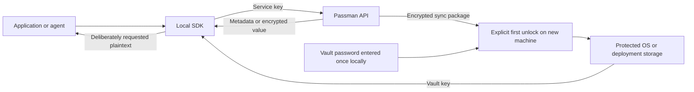

# Passman from scratch: product and design draft

Status: **accepted product design, 2026-11-20; fresh alpha implementation now available**. See [the implemented guide](fresh-quickstart.md) and [actual verification/platform gates](fresh-testing.md). The product choices in section 2 are confirmed by the user. The interfaces, storage adapters and cryptographic profile below are proposed engineering contracts, requiring implementation and verification. Examples do not run against the released SDK. This draft supersedes the earlier [SDK redesign proposal](sdk-redesign-proposal.md) and its legacy-compatibility assumptions.


Implementation contract: [fresh-quickstart.md](fresh-quickstart.md) documents the tested alpha interfaces where proposed examples below differ. Full account administrators can deliberately issue independently expiring/non-expiring read keys; delegated credentials remain bounded by parent scope/expiry, and administrative child credentials never extend the parent lifetime. Browser management can revoke either credential kind but cannot issue usable writer authority without local signing continuity.

## Latest amendment under security review

The user added two requirements after the original draft:

- The website shows an account-scoped, read-only inventory of registered installations and logical deployments, with last-seen and active/inactive status. There are no machine edit, delete or control actions in that view. This is not a census of physical machines or offline key copies.
- The website may **submit new secret name/value pairs only**; it cannot update/overwrite or delete them. Submissions remain pending until the user verifies their exact name/value in a trusted local client. Administrative CLI/SDK operations may create, activate, update and delete. Runtime read service keys remain read-only. Existing names must not be replaced through a create endpoint.

Three high-reasoning reviews are consolidated in [the security review](fresh-design-security-review.md). The user has answered all six review questions and the follow-up recovery edge case: pending website submissions with trusted local verification; separately authorized password bootstrap; installation/deployment inventory; recipient service authorization for transfers; headless administrative authority; full restoration with account login plus vault password; and no administrative recovery when the password is forgotten and only read-only keys survive. These choices are reflected below. The proposed public-key encryption/signature profile replaces the old local-only symmetric candidate; its wire details still need specification and verification before implementation.

## 1. Product purpose and three user-facing terms

An application or agent discovers projects and secret names, fetches encrypted values and, when matching local key material is available, receives plaintext through one SDK call. Ordinary reads never ask for a password, open a browser, enroll a device or request approval.

| Term | Meaning | Where it is used |
| --- | --- | --- |
| Vault password | User-chosen password protecting the encrypted synchronized vault and supported key-custody operations | Initial setup, first unlock on a new machine, deliberate key movement/settings changes, or password-based restoration |
| Vault key | Account-wide private decryption material from a versioned encryption keypair | Used locally by the SDK; identical copies for the account, never usable plaintext on the Passman server |
| Service key | Website-issued read-only API credential | Lists authorized metadata, fetches ciphertext and refreshes encrypted runtime keyrings; only an explicitly bootstrap-enabled key can fetch password-unlock material |

Project names and secret names are lookup addresses, not extra credentials. Internal wrapping keys and format versions are implementation details, not additional passwords users must manage. Account-management login is separate from runtime read access; a service key never acquires administrative authority implicitly.

## 2. Confirmed product decisions

1. Start from scratch. No compatibility with old SDKs, local vaults, ciphertext, website values or migration paths is required. This does not authorize deleting existing data, resetting accounts, publishing or deploying during design work.
2. Use one account-wide vault key, with versions for rotation. Project scopes restrict normal API access, not offline cryptographic authority. A workload with that key can decrypt matching ciphertext from any account project if it obtains it.
3. Service keys are read-only and may cover explicitly selected projects or explicitly all projects. They may expire or be explicitly non-expiring; all are revocable and replaceable.
4. Support JavaScript/TypeScript SDK and CLI on desktop and headless Windows, Linux and macOS, unattended Linux servers/containers, and ordinary Node.js cloud functions. Edge runtimes, mobile clients and a public browser runtime SDK are outside this release.
5. Configure protected machine/deployment storage once so ordinary application and machine restarts need no vault-password entry. The authorized runtime and its administrators are trusted to use the key.
6. Automatically synchronize encrypted vault material through Passman in the first release. A fresh machine can enter the vault password once to decrypt the synchronized package, then use its configured local storage. This password-based path does not require a source machine. The separate code-transfer path below can also bootstrap a machine.
7. Accept the resulting restoration capability: the encrypted synchronized package plus the correct vault password can restore access after local key copies are lost. Account login or a service key alone cannot decrypt it. No separate recovery-code, support escrow or offline-backup product is planned.
8. A surviving administrative machine with matching usable custody/signing material may reset a forgotten vault password after verified local OS access. Updating remote restoration/synchronization state additionally requires management authorization and administrative continuity. Decryption-only workload material is insufficient.
9. Website secret entry is create-only and pending. It cannot activate, overwrite, update or delete values. Activation requires the user to verify the exact name/value in the trusted local CLI/administrative SDK; this is an authoring action, not approval of ordinary reads. The website never requests the vault password or decryption key and cannot reveal existing values.
10. Support intentional plaintext retrieval by applications and agents, as well as using values directly in program code. Accidental logs, diagnostics and tracing must remain redacted. The SDK is not a sandbox against equivalent-user code.
11. Default plaintext reads accept only authenticated values activated/written by trusted local clients. The proposed profile separates account decryption material from local administrative signing authority. Unsigned website ciphertext is pending, never a fallback for an activated record.
12. One installation may hold vault keys for several independent accounts. Each account has one active account-wide decryption key; its copies on different machines contain identical decryption material. Select the account automatically from the chosen service credential, then select only that account's matching local vault/key version. A new machine, project or service credential does not create a new decryption key for that account.
13. Include SDK-based machine-to-machine transfer using a **long, high-entropy copy/paste code that expires and permits one recipient claim**. Transfer the selected account's existing decryption material plus authenticated account/vault/context details; do not generate a different account key on the receiving machine. This is an additional provisioning path, not a prerequisite for reads or a replacement for automatic synchronization. Short manually typed codes are excluded. Exact encoding and exchange details below remain a proposed engineering design, not an implemented protocol.
14. Inventory counts stable registered installations and logical deployments, not cloud-function cold starts. Show last contact and active/inactive status; never promise detection of offline copies or distinguish physical clones sharing an identity.
15. Password-based bootstrap requires account-management login or a service key with explicit new-machine-bootstrap permission. Normal app service keys cannot download the password wrapper; already provisioned clients still refresh runtime keyrings without prompting.
16. Code redemption requires both the complete transfer code and the recipient's own valid service key for the same account. The source credential is never copied.
17. Headless administrative scripts are supported with separately provisioned administrative credentials and local signing authority. Account login plus the vault password can restore full administration after loss of all admin machines; runtime synchronization material alone cannot recover administrative private keys.
18. If the vault password is forgotten and only read-only workload/decryption material survives, full administration is unrecoverable. No account-login, support, email-reset or read-key-based promotion/replacement bypass is provided for that vault. Existing reads may continue while the required runtime material and API authorization remain usable; that is not recovery of administrative authority.

## 3. Scope of the replacement

The replacement includes a new API, local vault/sync format, SDK, CLI and website management surface. Existing database schemas and endpoints are background evidence, not contracts to preserve. New code must use a distinct namespace/storage boundary until intentional cutover; SDK import must never inspect and rewrite an old vault.

The new design still needs engineering quality, scoped authorization, established cryptography, independent test evidence, credential redaction, package integrity and an intentional release procedure. Removing compatibility requirements does not waive those standards.

The proposed account model is one owner per account operating several machines/workloads, with several accounts allowed on one installation. Accounts are not merged because they share an email address, project name or secret name. Multi-user team roles are not assumed. Generic secret storage remains provider-independent; Passman does not call OpenAI, Vercel or other providers merely to retrieve a value.

## 4. Architecture and trust boundaries

| Component | Responsibility |
| --- | --- |
| Management website | Account authentication, project/service-key metadata, create-only pending secret submission and read-only installation/deployment inventory; no existing-value reveal, vault-password input or administrative signing key |
| API/database | Enforce account/project/operation scope; store readable metadata, authenticated ciphertext and encrypted synchronization packages; never decrypt values |
| Runtime SDK | Resolve explicit/local configuration, call read APIs, load local key material, authenticate and decrypt values in process |
| Administrative SDK/CLI | Initialize vaults, encrypt and authenticate values locally, upload/update/delete with separate management authority, synchronize and rotate keys |
| Local custody adapter | OS-protected storage or explicitly configured workload/platform secret source, selected during setup |

No mandatory broker, local web server, SSH transport or background daemon is required. Synchronization can run when an explicitly invoked command or SDK request needs a new key version; no separate script is required for normal reads.



Server/API compromise is distinct from compromise of a trusted local writer, its update channel, the OS account or deployment secret store. A server can deny service, hide records, alter informational metadata or replay old authenticated state. It cannot manufacture an activated value accepted by a reader with an independently pinned writer verifier. Malicious website code can capture newly typed input or submit attacker-chosen pending ciphertext; the user must verify exact content independently before activation.

## 5. First setup and ordinary use

### 5.1 First account/vault

1. Create/sign into an account using the management website and issue an appropriate service key. Creating a service key is an account-management action, not approval of each SDK request.
2. Run the explicit `passman init` command in the trusted local installation. Authenticate management access for initialization; neither a service key nor project creation may overwrite an existing vault.
3. Choose the vault password through hidden local input. Generate the account encryption keypair, independent administrative signing keypair and internal runtime-sync wrapping key locally using OS randomness.
4. Create separate runtime-sync and password-protected administrative-restoration packages. Pin the writer public verifier in authenticated bootstrap state. Upload only encrypted private material and the public keys/format metadata; preserve distinct read and admin custody locally.
5. Create projects through permitted management UI/CLI operations. Local CLI/administrative SDK entries are encrypted and signed directly. Website entries are encrypted in-browser to the account public key and remain pending until exact local verification and signed activation.
6. Verify local persistence with a synthetic local encryption/decryption round trip and metadata-only API checks. Do not insert test secrets into a real project or reveal a real value during setup.

If the account already has a synchronized vault, initialization returns `VAULT_ALREADY_EXISTS` with first-unlock guidance. It does not generate and commit a replacement key. Stage local creation until the server transaction result is known; interrupted creation is an inspectable pending state, not a reason to discard potentially bound material.

### 5.2 Existing local vault

The application supplies project/name. The SDK resolves a service credential, identifies its account, fetches ciphertext, loads only that account's matching local vault-key version, validates the requested record context and authenticates/decrypts. It returns the value directly. No browser, approval, vault password or separate decrypt command is involved.

### 5.2.1 Several accounts on the same installation

| Selected service credential | Account | Automatically selected decryption material |
| --- | --- | --- |
| Service key for A | A | Account A's local vault key |
| Service key for B | B | Account B's local vault key |
| Service key for C | C | Account C's local vault key |

The exact selection sequence is:

1. Select the service credential explicitly or from the deliberately configured default/profile. This chooses API/account context, not a decryption key by trial and error.
2. Resolve its stable account identifier and validate the authenticated API context. The proposed service-credential format carries a non-secret account-routing identifier alongside its random secret, so the SDK has an expected account before it sees response metadata. The server must validate that identifier against the credential's registered account; it is not sufficient authorization by itself.
3. Resolve the project/name within that account. Identically named projects or secrets in other accounts remain independent.
4. Locate local material by `(service origin, accountId, vaultId, keyId)`. Store/synchronize each account's vault and custody state in that namespace; do not use a global 'last unlocked key'.
5. Require the response's account, vault, project/name and key context to match the selected credential/request and its authenticated ciphertext before returning plaintext. A response naming another account is an error, even if that account's key is also available locally.
6. If B's material is missing, report B's provisioning requirement. Do not try A or C, choose whichever key decrypts, generate a new key, switch credentials or ask the user to select a vault key. Metadata/ciphertext operations for B still work.

The user does not supply an account ID or key ID on each ordinary request. These are SDK/API bookkeeping. Changing a service key within account B keeps B's vault key unchanged. Synchronizing B to another machine copies B's existing key; machine-specific OS wrapping may differ while the actual decryption material remains the same.

Only a deliberate vault-key rotation changes the account's active decryption material. Historical versions retained during such a rotation do not create different normal keys per machine or project. No rotation happens merely because a client connects or a new account profile is added.

### 5.3 Fresh desktop or headless machine

1. Configure its own read service key privately and select the account/origin. For password bootstrap, use account-management authentication or a service key explicitly allowed to bootstrap new machines; an ordinary runtime key is insufficient.
2. Run explicit `passman vault unlock`. Download the encrypted synchronization package and enter the vault password once, or supply it through an explicitly supported protected setup input for automated deployment.
3. Derive the password key locally, authenticate/decrypt the runtime bootstrap package, validate its account/vault/key context and pin the writer verifier before installing operational material in the chosen local custody store. Administrative restoration is a separate management-authorized action, not a side effect of read bootstrap.
4. Keep operational synchronization material locally so later key-version downloads and process restarts do not require the vault password again.

No existing machine has to be online or approve this process. Passman stores only encrypted key material. Passwords and usable keys never travel in API requests, URLs or process arguments.

### 5.4 Container or cloud-function deployment

Use the CLI/admin SDK to prepare protected deployment material and install it into the operator's secret facility. The runtime receives its service credential and operational vault/sync material through an explicit custody adapter. Container restart/replacement or a cloud-function cold start reads that same configured source; it never creates an identity or prompts.

Prefer runtime-mounted secret files or the platform's authenticated secret API. An explicit environment-based source is supported for ordinary Node.js cloud functions where file mounts are unavailable, with the platform configuration, process environment, support tooling and operators included in the trust boundary. Do not put values in images, Dockerfiles, build arguments, source files or public build variables.

The deployment source is operational key custody, not an additional offline-backup feature. A runtime lacking that source still supports metadata/ciphertext access and returns an actionable error for plaintext access.

### 5.5 Transfer an account's key using a code

The user requested an SDK operation that transfers the existing key and its associated account details from machine A to machine B. A source explicitly initiates this key-custody action; ordinary reads never initiate it. The receiving machine does not need to know the source's vault password when it holds a valid code for the proposed encrypted transfer.

Confirmed first-release code choice: an expiring, high-entropy copy/paste code with one recipient claim. The proposed transport is a server-relayed, end-to-end encrypted transfer package. Short manually typed codes and PAKE pairing are outside this release. Do not substitute a public lookup ID for the secret code or shorten its cryptographic secrets for convenience.

The proposed long-code flow is:

1. In the SDK's vault-management interface, select the source account explicitly or through an already bound credential/profile. Require its vault password for the supported key-movement operation. The source also needs separately configured account-management authority to create/cancel relay transfers; a read service key does not gain mutation rights.
2. Package only that account's origin, stable account ID, vault ID, active/needed key versions, key identifiers and operational synchronization material. Include safe identifying labels if useful. Authenticate these fields together so the receiver cannot attach the key to another account.
3. Encrypt locally using a cryptographically random transfer-encryption secret and established AEAD. Use an independently generated high-entropy claim credential for relay redemption; persist only its verifier/hash on the server. Transfer ID, expected origin/account and both independent capabilities form the copy/paste code. Exact serialization is a specification task.
4. Upload the encrypted package, bounded expiry and claim verifier. The server receives neither the full code nor the transfer-encryption secret. The code is deliberately conveyed to the intended recipient through a trusted channel, not published in a model prompt, URL or ordinary log.
5. Machine B invokes the SDK's receive operation with that code, its own valid same-account service key and a supported local/deployment custody mode. Validate the configured service origin and account/code context before sending credentials; never forward them to an arbitrary code-selected host. Present the transfer ID and relay claim credential in addition to account authorization. The transfer-decryption part stays local.
6. Decrypt/authenticate locally, verify origin/account/vault/key binding, and stage installation under that account's namespace. Preserve any existing A/C accounts and refuse an incompatible B vault rather than silently overwriting it. Verify persistence by a local synthetic round trip, then commit atomically.
7. After the target confirms durable installation, acknowledge delivery and delete the relay's active encrypted package. Retain only bounded safe lifecycle metadata. The source's existing key is retained; transfer copies it rather than moving/deleting it.
8. The target's ordinary service credential identifies this account, and subsequent SDK reads select the received key automatically. Protected local storage and any transferred sync authority support later restarts/version refreshes without reusing the transfer code.

Do not include the source's vault password, service keys, management session, private administrative signing key or other accounts' material in the normal transfer package. Include runtime sync authority and the pinned writer public verifier explicitly so the recipient can refresh versions safely. The recipient needs its own same-account service key for both claiming and later reads; that key need not have password-bootstrap permission. A code does not issue a credential or grant administration. Administrative workstation restoration/provisioning uses separate management-authorized custody, rather than silently escalating a normal key transfer.

Code redemption must use an atomic state transition so only one claim session wins. Persist destination staging state and an independently generated recipient-session secret/proof before claiming. The relay stores its verifier; the same proof is required for bounded retries and acknowledgement. An inspectable attempt ID alone is insufficient. Recheck recipient credential/account authorization on resumed requests. A disconnected response is uncertain delivery, not a reason to consume another code or overwrite a working destination. Source status/cancellation and destination completion are metadata-only, account-scoped where applicable and redacted.

One successful recipient claim and expiry are confirmed requirements. Proposed defaults are ten-minute validity, cancellation, request limits and deletion after confirmed receipt. Resuming the same authenticated claim is not a second recipient claim. The first holder of the full code plus valid same-account service authorization can claim; this is not physical-device attestation. Bind transfer ID, account/origin, expiry and the source's observed epoch/revision floor into authenticated payload context. Expiry/exclusivity govern the honest live relay: a malicious relay can ignore them, and captured ciphertext plus the complete code can still decrypt offline. No protocol revokes an already copied vault key by expiring its transfer code.

Suggested SDK shape, not released code:

```ts
// Source: vault-management access is explicit and already authorized locally.
const transfer = await sourceVault.createTransfer({ expiresInSeconds: 600 });
// Convey transfer.code privately to machine B; do not log it routinely.

// Destination: receive existing account material into protected custody.
await PassmanVault.receiveTransfer({
  code: receivedCode,
  serviceKey: recipientServiceKey,
  storage: destinationStorage,
});
```

`PassmanVault`, `sourceVault`, `receivedCode` and `destinationStorage` describe the proposed SDK contract and configured objects. They are not currently exported/runnable interfaces. Creation, receive, safe status and cancellation belong to the same package's separate vault-management surface, not to runtime secret-read methods. The code is a temporary transfer credential, not a fourth permanent user-managed key.

## 6. Automatic encrypted synchronization

Proposed role-separated envelopes use standard password derivation, authenticated envelope encryption and writer signatures:

| Package | Contents and protection | Download authority |
| --- | --- | --- |
| Runtime bootstrap | Runtime sync key, pinned writer public verifier, account/vault binding and observed epoch floor; password-derived encryption | Account-management login or an explicitly bootstrap-enabled same-account service key |
| Runtime keyring | Versioned private decryption keys, public encryption keys and write/retirement metadata; encrypted by runtime sync key and signed by the administrative writer | Ordinary same-account read service key; no password wrapper returned |
| Administrative restoration | Private administrative signing authority and required custody state, bound to the same vault/root; separately password-encrypted using a purpose-separated key | Account-management login only; vault password decrypts locally |

The runtime sync key must not decrypt the administrative restoration package. Its private signing material is not hidden merely by omitting it from a normal export. Neither runtime packages nor standard code transfers contain private writer authority, management sessions, source service keys or the vault password.

Use a vetted bounded password-KDF implementation and standard AEAD/signature libraries. Bind package purpose, format, canonical origin, account/vault, sync-key ID, root verifier and revisions into authenticated context. Reject excessive or downgraded KDF parameters before expensive work. Final parameters and byte formats require interoperability and target-runtime evidence.

Pin the writer public root from authenticated initial setup, password bootstrap or trusted code transfer. Verify each mutable runtime keyring's signature against that pinned root before accepting key versions or writer policy. A runtime holding the sync key can otherwise re-encrypt a forged keyring and substitute its own writer verifier; encryption alone does not establish administrative authorship. Never replace the pinned verifier just because an API/keyring response names another key. Root replacement needs an explicit authenticated transition or uncompromised re-provisioning.

Password-wrapper and keyring revisions are independent within one sync epoch; routine keyring updates do not require the password. Replacing the sync epoch must atomically update compatible bootstrap, runtime and administrative-restoration state with expected revision/epoch checks. A password reset racing with rotation must conflict rather than commit a wrapper for an obsolete sync key. Newly created/restored runtimes receive the original account decryption material, not a new per-machine identity.

Already provisioned runtimes keep their sync key locally and refresh the signed encrypted runtime keyring without a prompt. Rewrapping the same sync authority for a password change leaves those runtimes working; it does not revoke their copies. A normal app credential lacks password-bootstrap and administrative-restoration download rights even though its data access remains read-only. Enabling bootstrap is a deliberate credential capability, not automatic escalation after a denied request.

The account-wide decryption trust boundary still applies: an authorized reader holding its account's private decryption key can decrypt other captured account ciphertext. Separate writer keys restrict forgery/administration, not that accepted confidentiality scope.

Passman cannot magically discover a password or a missing local key. An ordinary `getSecret` call never prompts for first unlock. If the required local bootstrap is absent, metadata/ciphertext reads work, but plaintext retrieval returns `VAULT_NOT_PROVISIONED`. Explicit setup supplies the missing authority once.

On an unknown key version, the SDK may fetch the encrypted keyring once using already provisioned sync authority. If authentication fails or the key remains unavailable, stop with a typed error; never generate a substitute key, weaken authentication, or ask the model for a password.

The precise serialization, concurrent-update protocol and allowed KDF/AEAD profile must be finalized and independently reviewed before implementation. Use strict parsing and the existing engineering standards; do not invent a pairing, PAKE or short-code transfer protocol.

## 7. Authenticated record encryption

The proposed profile now uses established public-recipient encryption, such as RFC 9180 HPKE with X25519/HKDF-SHA256/AES-256-GCM, plus separate Ed25519 administrative signatures using a maintained standardized signed-container/request profile. This replaces the old symmetric-only candidate. Each account has one active decryption private key copied identically across its machines; public encryption keys are safe to publish. Additional writer/sync material is internal, not another password the user must supply for ordinary reads.

Authenticated encryption and writer signatures bind protocol/format, canonical service origin, account/vault, project ID and exact requested project name, secret ID and exact name, encryption key epoch, revision/incarnation, operation and activation state, including the encrypted envelope bytes. Construct expected identity/name context from the request and pinned credential/profile, not solely from server fields. Renames require deliberate authenticated transitions rather than metadata rewrites.

### 7.1 Pending website submission

The ordinary trusted page encrypts a new value to the account's public encryption key before upload. The API performs only atomic create-only insertion with canonical name uniqueness and a client idempotency receipt. It never upserts, overwrites or activates. A key substituted by malicious hosted code may make the submission unreadable or expose the new input; browser cryptography cannot protect text from the page accepting it.

Label this ciphertext pending and unsigned. Metadata may show the pending state. Ordinary `getSecret` and existence semantics for usable values must not treat pending data as activated, fall back to it, or silently return it when a signed value is missing. An explicit metadata query may distinguish pending from absent without releasing its plaintext.

### 7.2 Trusted verification and activation

The user opens the pending item in the installed trusted CLI/administrative SDK flow, decrypts locally and verifies the exact account/project/name and plaintext against their intended value. Do not automatically activate after successful decryption, blindly sign a server-provided envelope, or rely on a hosted-page confirmation as independent verification. A local operator must deliberately confirm the exact content; programmatic workflows that already know the intended value should use direct administrative creation.

After verification, the local administrative client encrypts/signs the activated record using private signing authority absent from the website and runtime deployments. An authenticated activation command binds the pending record's expected revision/digest and exact resulting context. The honest API authorizes and commits activation with its audit event atomically. Active update/delete/project-destructive actions also require administrative credentials and local signing proof, rather than a browser session alone.

Normal readers require a valid signature rooted in their independently pinned writer verifier before returning plaintext. An attacker cannot make an unsigned website submission acceptable by relabeling it active, replacing a name-to-ID mapping, or serving an API-supplied verifier. Verify signature/context and decrypt; default to rejection, not a weaker web-origin mode.

The signing authority authenticates authorized administrative writing, not a unique physical machine or human. Runtime decryption material does not grant a signing key. Website sessions cannot mint usable native-administration authority on their own; issuing it requires the separately protected local authority and account management. Compromise of a trusted writer/signing key is a different threat from compromise of the storage server.

Signed activated records can still be replayed or hidden. Define observed revision floors per authenticated name/incarnation history, signed tombstones and permitted recreation transitions so legitimate deletion/recreation neither resets trust silently nor creates false rollback alarms. A fresh/stateless client has no independent latest-state witness. Global latest-state and metadata completeness are not promised; signatures do not make the server an anti-rollback authority.

## 8. API and SDK surface

### 8.1 Read APIs

| Method | Inputs | Output | Local vault required? |
| --- | --- | --- | --- |
| `listProjects` | Service credential | Authorized project IDs/names, counts and creation/update metadata; paginated | No |
| `listSecrets` | Project | Authorized secret names, IDs, pending/active state, revisions and timestamps; paginated | No |
| `hasSecret` | Project and name | Record existence including pending submissions; not a promise of activated/readable plaintext | No |
| `getEncryptedSecret` | Project and name | Bounded versioned ciphertext envelope and context | No |
| `getSecret` | Project and name | Writer-verified, locally decrypted activated string; pending submissions return a typed verification-required error | Yes |
| `status` | Optional project/profile | Safe credential scope/expiry and local custody readiness | No key reveal |

Metadata lists/counts expose only the credential's authorized projects. Unknown projects outside scope must not be enumerable. Schema-valid ciphertext returned without a vault key is not yet cryptographically verified; `getSecret` performs that verification.

Proposed TypeScript usage, not a released interface:

```ts
import { PassmanClient } from "@07rjain/passman";

// Uses an explicitly configured default profile and protected local storage.
const passman = await PassmanClient.connect();

const projects = await passman.listProjects();
const names = await passman.listSecrets({ project: "billing" });
const encrypted = await passman.getEncryptedSecret({
  project: "billing",
  name: "OPENAI_API_KEY",
});

const apiKey = await passman.getSecret({
  project: "billing",
  name: "OPENAI_API_KEY",
});

// Pass apiKey to the intended provider/application code.
// Returning it to an agent is supported when deliberately requested.
```

Applications may explicitly supply a service key from their own private configuration. Connection and metadata methods must work without local vault material. An explicit profile pins origin/account; if no credential/profile is selected and several could be used, require credential/profile selection instead of guessing. Once a service credential is selected, account-to-vault-key selection is automatic, even when several account keys are stored locally. A rejected explicit credential never falls back to a broader saved one.

`getSecret` returns a normal string; an intentionally stored empty string is valid. No wrapper, callback or separate script is required. The SDK never prints values, caches plaintext on disk or mutates `process.env` implicitly. Optional task tools may keep values internal, but that is not mandatory for deliberate raw retrieval.

### 8.2 Administrative authority

Generate high-entropy random read service credentials, display each usable credential once, and persist only its cryptographic verifier/hash plus scope, optional expiry, revocation state and safe identifying metadata. The live API receives the bearer credential over HTTPS; hash storage does not hide that live credential from a compromised API process. Never place it in URLs, logs or traces. Credential replacement updates protected local/deployment configuration without changing the vault key.

The runtime client exposes no secret mutation method. The separate administrative SDK/CLI may create, activate, update and delete; each requires a scoped administrative credential and locally held signing authority. A runtime service key plus decryption material is insufficient. The website can submit pending creates and manage permitted metadata/service-key operations, but it cannot activate/update/delete values or obtain private writer authority merely through its browser session.

Headless scripts/CI are explicitly supported: provision administrative credentials, their operation/project scope and private signing authority separately from read workloads. Check expiry/revocation and scoped operation permission on every administrative request, and sign its exact method/path/body/context, credential identity, expected revision/epoch, nonce and time validity using a maintained request-signature profile. Stored record signatures separately authenticate values to readers. Credential issuance/renewal must not expand scope or be exercisable by ordinary website sessions without trusted local authority.

Ordinary authorized administrative operations do not require a browser or vault-password entry per write. Vault-password custody actions remain deliberate. Expired/revoked native administrative credentials return typed errors without opening interactive login inside SDK requests. Account login alone authenticates the owner but does not supply private writer material; full restoration additionally requires the vault password and administrative recovery package.

Website creates are pure atomic inserts with canonical uniqueness shared across all writers. Bind idempotency receipts to actor/action/context/request digest; never upsert or use check-then-overwrite. Native administration alone may perform destructive project operations, signed tombstoning and deliberate recreation. A website cannot delete/rename/reassign a project or reclaim a tombstoned name as an indirect overwrite path. Recheck current authorization, active encryption epoch and writer state at commit, with atomic audit events.

Define versioned endpoints for read context/status, metadata, ciphertext, encrypted sync downloads, administrative encrypted mutations and encrypted sync updates. All are new contracts; no existing endpoint or database format is assumed. Successful mutations and their safe audit events commit atomically. Bound administrative retries by explicit idempotency/revision semantics; a lost response is not permission to blindly repeat a write.

### 8.3 Proposed CLI commands

| Command | Purpose |
| --- | --- |
| `passman init` | Explicit first-vault creation and custody setup |
| `passman service-key save` | Save a website-issued read credential using hidden/protected input |
| `passman vault unlock` | First-machine unlock of the encrypted sync package; configure operational custody |
| `passman vault sync` | Refresh using already configured synchronization authority; noninteractive after setup |
| `passman vault transfer create` / `receive` | Explicitly transfer the selected account's existing material through a private expiring code; SDK operations are the underlying interface |
| `passman projects` / `passman list --project NAME` | Metadata-only discovery |
| `passman get --project NAME --name KEY` | Deliberately print plaintext to stdout; never log the service/vault key |
| `passman put --project NAME --name KEY` | Hidden local input, authenticated encryption and administrative upload |
| `passman pending verify --project NAME --name KEY` | Trusted local preview and exact-content confirmation, then signed activation; not a generic read approval |
| `passman vault password change` / `reset` | Deliberate custody action; forgotten-password reset requires surviving administrative/custody material and verified local access, never only read-workload keys |
| `passman vault rotate` | Explicit account-wide key rotation and operational rollout |
| `passman status` | Safe scope/expiry/storage diagnostics |

These names are proposed. Setup secrets are never command-line arguments. Noninteractive setup requires an explicit protected input/source. Automatic synchronization is built into the SDK where necessary; users do not run `vault sync` before every read. Additional deletion/import commands must follow the same authority and redaction model without expanding runtime read scopes.

### 8.4 Read-only machine inventory

Count registered installations and logical deployments per account/origin. Use a stable installation/deployment ID persisted during custody setup or in deployment configuration; service-key rotation, restart, replacement container and function cold starts reuse that ID. Display safe labels, setup origin, registered time and last observed contact, with distinct registered and recently-active/inactive counts. No website edit/delete/control buttons or machine-revocation guarantee is implied.

Registration is informational, not physical-device attestation or proof that every key copy registered. Distinguish client-reported setup completion from server-observed API activity. Copied images may share IDs and unregistered/offline copies remain invisible. Ordinary service credentials grant no secret-mutation rights; any bounded inventory self-report/observation interface must be narrowly account-scoped, capped and explicitly documented as bookkeeping. Do not make successful inventory registration an availability/approval prerequisite for secret reads.

Last-seen updates should be bounded/coalesced rather than producing a database write per secret request. Escape labels, prevent cross-account attribution, control anonymous/unrecognized IDs and define stale-entry retention without claiming that inactivity proves key deletion. Concrete ID/proof/observation formats remain engineering specification work.

## 9. Custody and supported runtimes

| Environment | Proposed custody | Startup expectation |
| --- | --- | --- |
| macOS desktop | Keychain-backed operational storage | Available after OS login; validate SDK reads from the application's own Node binary and after updates |
| Windows desktop | Current-user protected storage/DPAPI plus validated NTFS permissions | Available to configured user; a service identity needs its own provisioning |
| Linux desktop | Secret Service when available | Available after keyring unlock; unavailable stores produce setup guidance rather than a silent fallback |
| Headless Linux | Explicit systemd credential source or operator-provisioned protected runtime secret files | Noninteractive after reboot when the configured source is available |
| Containers | Explicit runtime secret mounts or authenticated deployment secret source | Works after replacement/restart; fail clearly when mounts/identity are wrong |
| Headless Windows/macOS | Explicit service-account storage and native permissions/credential facility | Test before-login/service-start behavior separately from desktop login |
| Ordinary Node.js cloud functions | Explicit platform secret API, mounted source or deliberately selected private environment injection | Cold starts require no browser or local persistent disk |

No universal keychain is assumed. The implementation must select concrete adapters and minimum OS/runtime versions, and prove installed-artifact support. Preserve the current verified Node.js 24 baseline for the draft; changing that baseline requires its own compatibility evidence. Native OS bindings versus packaged helpers is an engineering decision that must account for OS/architecture distribution, latency and secret-safe IPC.

Never embed secret payloads in process arguments, PowerShell command text or shell interpolation. OS helpers receive them through bounded private pipes. Desktop owner-only path checks and deployment-mounted secret validation are distinct policies: support explicitly configured root-owned/read-only mounts without weakening desktop checks or indiscriminately accepting replaceable symlinks. Validate allowed mount targets, ownership/readability and race-safe handle use for each adapter.

A plaintext key file or environment source protected by OS/deployment permissions is not hardware protection or cryptographic disk encryption. A wrapper whose unlock key is stored beside it provides no independent barrier against theft of both. Setup/status must identify the actual custody mode and its boundary honestly.

In-process key handles may be cached for the client instance lifetime to avoid an OS helper per read. No memory-erasure guarantee is made for JavaScript strings or a compromised process.

## 10. Password change, restoration and key compromise

### 10.1 Password change/reset

Changing the vault password rewraps runtime bootstrap and administrative-restoration material; it does not re-encrypt provider values or revoke machine copies. A global reset must preserve both readable runtime state and recoverable administrative private state in an atomic compatible epoch. Require management authorization plus trusted local signing/continuity proof bound to the current vault/sync epoch, wrapper digests and expected revisions. A generic management session or caller-supplied 'OS verified' flag is insufficient.

With surviving administrative material, verified local OS/operator access can authorize forgotten-password reset without the old password. If only read-only material survives and the vault password is forgotten, the user explicitly chose no administrative recovery. Read/deployment keys cannot reconstruct an absent private signer, authorize writer-root replacement or overwrite a restoration package that cannot be rewrapped. Account login, support and email reset do not bypass this limit. Existing authorized decryption may continue; no operation may describe that as restored administration.

Desktop verification uses an appropriate native OS authentication mechanism where supported. Headless reset needs a documented authenticated operator procedure; ordinary SDK reads cannot invoke it. Possessing a service key, an email reset or a support request is insufficient. A surviving read-only runtime cannot silently promote itself into account administration.

### 10.2 Restoration from synchronized material

A fresh client with permitted bootstrap access and the correct vault password can restore decryption after every local key copy is lost. Separately, account-management login plus that password can download/decrypt administrative-restoration material and restore full writer administration; a runtime token alone cannot do so. This explicitly supersedes the old no-recovery statement. Passwords are entered/decrypted only in the trusted local client. Server snapshots can contain encrypted restoration material, making a strong password and bounded vetted KDF necessary.

If neither usable local material nor a decryptable synchronized package/password remains, provider credentials must be replaced. Passman has no server-side plaintext escrow, recovery code or support bypass. Old password-wrapped snapshots remain decryptable with the old password; password changes cannot erase those copies.

If an old captured password wrapper exposes the still-current sync key, its holder may also decrypt later keyring content encrypted under that sync key. A password change alone is not revocation of that authority; suspected compromise requires the separate sync-authority replacement procedure below.

### 10.3 Rotation and decommissioning

Service-key replacement changes API access without re-encrypting values. Allow two credentials during rollout, install the new one privately, verify access, then revoke the old one. Non-expiring keys do not become irrevocable keys.

Routine vault-key version rotation uses the existing sync authority to distribute new versions automatically. A full re-encryption operation uses trusted local code, explicit administrative authority, bounded batches and optimistic revisions. Old captured ciphertext remains exposed to anyone holding its old key.

After suspected compromise of a workload holding account-wide material, revoke affected API credentials, rotate provider secrets across affected projects, replace decryption and sync authority, and change the vault password so a fresh unlock using the new password cannot accept an old compromised wrapper. Advance write-recipient/retirement epochs atomically; reject new website submissions/activations/local writes encrypted for retired epochs. Retained machines require uncompromised re-provisioning. Reusing compromised sync authority would reveal new keys to the attacker. If administrative signing authority was compromised too, replace/re-pin its root through an independent trusted transition; never accept a new verifier solely from the API. No physical-device revocation is claimed.

Decommissioning revokes that workload's service credentials and removes its local/deployment custody material. It cannot prove all copies were destroyed. Account-wide confidentiality cannot be restored merely by deleting one machine's profile.

## 11. Failures and agent behavior

| Error category | Observable behavior |
| --- | --- |
| Missing/ambiguous configuration | Select/configure a profile explicitly; never switch accounts silently |
| Missing/expired/revoked service credential | Return a redacted credential error; never ask for the provider secret or use a broader token |
| Out-of-scope project | Return scope denial without exposing another project's metadata |
| Missing secret in an authorized project | Return a genuine missing-value result, distinct from forbidden access |
| Pending website submission | Report verification required; ordinary plaintext reads never activate, return or silently substitute the pending value |
| Vault not provisioned | Metadata and ciphertext still work; plaintext fails with first-unlock guidance |
| Locked/unavailable custody source | Explain OS/deployment remediation; never prompt inside ordinary retrieval |
| Unknown vault-key version | Refresh encrypted sync state once with configured authority; fail if unavailable |
| Context/authentication failure | Release no plaintext, do not overwrite key state and do not retry with weaker checks |
| Rate limit/network failure | Bounded safe-read backoff with cancellation; no tight retry loops or plaintext fallback |

The API must define its own typed wire errors and privacy behavior; the SDK maps them into stable public errors. Distinguish malformed/unknown credentials from a real credential's expiry/revocation where disclosure is permitted. Do not turn an authorization or availability error into `false`/an empty string.

Missing values can be created locally by the administrative CLI/SDK or submitted pending through the website. A runtime read credential cannot create/activate the value, and a model should not request unrelated setup passwords in chat. Deliberately returning an activated stored value as plaintext is supported; background tracing and ordinary diagnostics remain redacted.

## 12. Delivery and acceptance

1. Review this draft against the confirmed choices; finalize its wire/profile, admin authentication, custody adapters and destructive-action semantics. Do not restart legacy migration work.
2. Specify the new versioned formats and APIs, authenticated contexts, synchronization/password-reset concurrency and key-rotation state transitions using maintained crypto implementations.
3. Build isolated crypto/sync and API authorization foundations, then installed SDK/CLI artifacts and desktop/workload custody.
4. Complete first setup, new-machine first unlock, automatic sync, metadata/ciphertext/plaintext calls and local administrative writes.
5. Complete website pending creation, trusted local verification/activation, metadata/service-key management, read-only machine inventory, platform/cloud-function acceptance, role-separated restoration/rotation and redacted operations.
6. Run the fresh-design acceptance cases in [feature.md](feature.md#fresh-design-acceptance--implementation-evidence), obtain independent security review of the new formats/trust boundaries, and plan an intentional release/cutover. Existing deployed state is not erased by any design-document update.

No old fixture results establish these capabilities. Required cases cover wrong password, package substitution/corruption, offline guessing assumptions, total-local-loss restoration with the password, forgotten-password local reset, no server-only recovery, unauthorized writes, no-prompt fresh processes/reboots/cold starts, supported mounted-secret policies, malicious-server replacement rejection, replay limits, empty projects/values, credential scope/expiry/replacement, concurrent sync/reset/rotation and account-wide key compromise.

## 13. Engineering specification work still required

- Pin crypto/KDF libraries and parameters, byte encodings, nonce/usage bounds, authenticated contexts and interoperability fixtures. No library is selected or audited merely by naming the algorithms here.
- Define public SDK signatures, pagination, metadata fields, API request/response bounds and exact error codes. Examples above are proposed shapes.
- Define normal administrative CLI login, management-session renewal, idempotency, sync revisions and explicit destructive reset/delete behavior. Keep those authorities out of runtime read profiles.
- Select and test concrete OS/deployment custody adapters and distribution packaging; publish a supported version/architecture matrix rather than claiming every environment works automatically.
- Finalize the long copy/paste transfer-code encoding, relay authorization/state/retry contract, encrypted account-bound payload and expiry/cancellation profile. One recipient claim and expiry are required; short-code alternatives are excluded. Do not substitute a public identifier or low-entropy AEAD key.
- Specify rollout behavior for routine key versions versus compromise-driven sync-authority replacement, including partial failures, observability and concurrency.

These are specification tasks, not new requirements for user-managed credentials or ordinary-read approvals. No product implementation, deployment or deletion has occurred in this drafting step.
