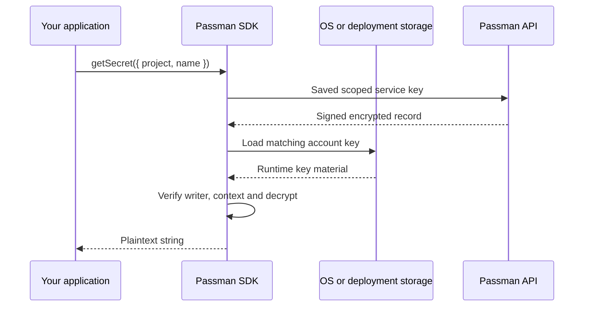

# Fresh Passman: local alpha guide

This guide is for the new `@passman/sdk` **1.0.0-alpha.1** source implementation and `passman` CLI on Node.js 24. It uses `/api/passman/v1`, the separate `passman_v1` PostgreSQL schema and separate local custody. It does not import old vaults or data. The signed alpha archive and matching website are now published; consult [release status](FRESH_CHANGELOG.md) for verified scope and limits. Start with synthetic secrets; see [verification and platform gaps](fresh-testing.md).

## The three things you configure

| Term | Purpose | Needed for ordinary retrieval? |
| --- | --- | --- |
| Vault password | Unlock the synchronized package on a new machine, restore administration, or authorize supported custody exports | No |
| Vault key | Decrypt the account's values locally; every provisioned machine has the same active account key | Loaded automatically from configured custody |
| Service key | Read authorized projects, secret names and ciphertext | Saved once or injected by deployment |

The application receives plaintext deliberately. Keep it out of logs and normal model conversations. A service key without the local key can retrieve ciphertext and metadata, but cannot decrypt. The account carried by the credential selects the local vault; another account's key is never tried.



## Build and configure an isolated server

From the `mvp` workspace:

```sh
npm ci
npm run build
npm run test:fresh:isolated
npm run test:fresh:package
```

The isolated test command starts and removes its own PostgreSQL container. It requires Docker access and never uses the application's database configuration.

For a separate development database, configure `PASSMAN_MIGRATION_DATABASE_URL` privately with its owner connection and `PASSMAN_RUNTIME_ROLE` with an existing restricted login. Then run:

```sh
npm run db:fresh -- migrate
npm run db:fresh -- grants
```

The web process needs `PASSMAN_DATABASE_URL` for the restricted connection, `APP_ORIGIN`, `CLERK_JWT_KEY`, `CLERK_ISSUER` and the existing Clerk publishable-key configuration. Use HTTPS except on loopback development. Configure no production secret in a test shell. The route does not run migrations automatically. The earlier `DATABASE_URL` serves the earlier API and is independent.

Open `/passman` for the new management page. Start the configured website using its normal workspace development/start command. A working Clerk instance is required for interactive login; synthetic JWTs used by automated tests are not a production authentication bypass.

## Install the alpha

After the signed prerelease is available:

```sh
curl -fsSL https://passman.subdomain.wtf/install-v1.sh | sh && . "$HOME/.local/share/passman/env"
export PASSMAN_ORIGIN=https://passman.subdomain.wtf
```

For applications, install the self-contained GitHub archive:

```sh
npm install https://github.com/07rjain/passman/releases/download/passman-v1.0.0-alpha.1/passman-1.0.0-alpha.1.tgz
```

The package remains `@passman/sdk`. The signed installers expose `passman`; npm installs also expose the `passman-v1` alias. On Windows, download and review the script before executing it, then configure this PowerShell session:

```powershell
Invoke-WebRequest -Uri https://passman.subdomain.wtf/install-v1.ps1 -OutFile "$env:TEMP\passman-install-v1.ps1"
& "$env:TEMP\passman-install-v1.ps1"
$env:Path = "$env:LOCALAPPDATA\Passman\bin;" + $env:Path
$env:PASSMAN_ORIGIN = "https://passman.subdomain.wtf"
```

The original installer/release channel remains separate. These install commands require the release assets to have been published; they do not establish that publication occurred.

## Desktop setup once

For source development, invoke the compiled CLI with `node packages/passman/dist/cli.js` wherever this guide shows `passman`. Local installation can consume both packed protocol and SDK tarballs; neither package has been published by this work.

```sh
passman login
passman init
```

Keep the origin configured during installation. For source development only, use your configured local server origin, such as `http://localhost:3100`, instead of the hosted origin.

Login prints a short-lived connection link and connection code. Paste the code from your terminal into the signed-in page to connect that client. `init` asks for a new vault password locally and prints a non-secret account ID. Initialization keeps durable staged material when the outcome is uncertain. Existing accounts use `admin restore` or `vault unlock`, never a new key.

The saved management credential lasts ten minutes; run `login` explicitly when another management session is needed. It never opens a browser during a normal SDK read or write. Initial administrative credentials last 30 days; administrative credentials may last at most 90 days and need deliberate renewal/enrollment. Read keys have optional expiry.

The browser connection link expires after five minutes. Keep `passman login` running and copy the link and complete connection code from that same invocation. If your website sign-in is older than ten minutes, the connection page asks you to verify it through Clerk before retrying approval. Cancelling verification leaves the connection unapproved. If the link expires while verifying, run `passman login` again and use both its new link and code. The account menu lets you sign out and sign in again if the website session is unavailable. Connection errors do not require deleting your vault.

```sh
passman project create --account ACCOUNT_UUID --project demo
passman put --account ACCOUNT_UUID --project demo --name OPENAI_API_KEY
```

`put` reads the value through hidden input. `update`, `delete` and `recreate` are separate administrative actions; updates use optimistic revisions. Secret names are case-sensitive ASCII addresses, not passwords. Empty strings are valid values.

In `/passman`, create a read service key scoped to `demo`. Enable bootstrap only if you want this credential to set up a new machine with the vault password. Choose an expiry or explicitly allow no expiry. Save the displayed key locally:

```sh
passman service-key save --default
passman get --project demo --name OPENAI_API_KEY
```

Initial `init` already installed runtime custody on that machine. A different machine must explicitly run `vault unlock` with a bootstrap-enabled key, or `vault unlock --management` after login. The service key and vault password use hidden input. Subsequent retrieval needs only project/name. The final command deliberately prints plaintext without appending a newline. The first saved account becomes the default; use `--default` or `--account` deliberately when several accounts exist. Removing that default never selects another account automatically.

The administrative CLI can also issue a read key, deliberately displaying it once:

```sh
passman service-key create --account ACCOUNT_UUID --project-id PROJECT_UUID --label worker --non-expiring
```

Only full account administrators can issue read credentials independently of their own administrative expiry. Delegated administrators cannot widen project, operation or expiry limits. Administrative child credentials always remain bounded by their parent's expiry.

## Retrieve in application code

```ts
import { connect } from "@passman/sdk";

const passman = await connect();
const apiKey = await passman.getSecret({
  project: "demo",
  name: "OPENAI_API_KEY",
});

// Pass apiKey directly to the authorized provider client. Do not log it.
```

`connect` uses the configured origin and explicit service key, then `PASSMAN_SERVICE_KEY`, then a selected/default saved account. An invalid explicit key never falls back. A missing or ambiguous profile fails. `RuntimeClient` also accepts explicit options for applications that prefer no environment/default resolution.

`listProjects()`, `listSecrets({project})` and `getEncryptedSecret({project,name})` need no local decryption material. Ciphertext returned by the latter is a validated transport record, not a claim of trusted authorship; `getSecret` verifies the pinned writer before returning plaintext. Missing local custody, locked storage, pending verification and revoked/expired credentials produce typed `PassmanError` codes. Values never become empty strings merely because an operation failed. Safe GET transport failures retry once with the same authorization; mutations are not blindly retried.

## Another machine and unattended deployments

For password bootstrap, configure that machine's own same-account bootstrap-enabled service key, run `vault unlock` once, then retain only the required runtime credential/custody. Management-authorized runtime unlock is available as `vault unlock --management`. Administrative restoration is separate:

```sh
passman login --no-browser
passman admin restore
```

Headless Linux may use explicitly selected owner-only files instead of a desktop keyring. Pass `--file-mode --store-dir /absolute/protected/directory` consistently to login/setup/read commands. The containing directory must belong to the operator or root and have no untrusted writable ancestors. Files hold plaintext runtime/admin material protected by filesystem permissions; the vault password is not a runtime security boundary.

For containers, mount a deployment-protected runtime JSON file and inject the service key through the deployment's secret facility:

```ts
import { RuntimeClient, mountedRuntimeCustody } from "@passman/sdk";

const passman = new RuntimeClient({
  origin: "https://passman.example.test",
  serviceKey: process.env.PASSMAN_SERVICE_KEY!,
  custody: mountedRuntimeCustody("/run/secrets/passman-runtime.json"),
  installation: { label: "production-worker", kind: "container" },
});
const apiKey = await passman.getSecret({ project: "demo", name: "OPENAI_API_KEY" });
```

The POSIX mount adapter accepts the configured owner/root and approved read-only/group-readable mount policy, including bounded trusted Kubernetes-style symlinks. It rejects writable/untrusted targets. Do not mount administrative signing material into a read-only workload. Ordinary Node.js functions may use `environmentRuntimeCustody("PASSMAN_RUNTIME_JSON")` or a custom `RuntimeCustody` adapter that reads the deployment's protected secret facility. Explicit environment injection is an operator choice; traces and environment dumps must not disclose it.

`vault export-runtime` requires management authorization and the vault password, emits runtime-only material to a nonterminal pipeline, and assigns a distinct logical installation ID. Send it straight to protected deployment storage. Reuse that stored ID across restarts and cold starts. Supply an `installation` label/kind to report last-seen; inventory is informational and never required to decrypt. Cloned or offline copies cannot be enumerated reliably.

## Code-based transfer

The source needs its administrative profile, a current management login and the current vault password:

```sh
passman vault transfer create --account ACCOUNT_UUID
```

Deliver the intentionally displayed full code privately. On the receiver, configure its own same-account service key and run:

```sh
passman vault transfer receive
```

The code expires after about 9½ minutes by default and permits one receiver claim. Claim and encryption secrets are independent. Source credentials, password and private writer authority are excluded. Receiver proof is stored before claiming; acknowledgement follows durable storage, read-back and a local crypto round trip. Repeat an interrupted receive with the same code/store. An expired/terminal failed session can be replaced. Existing unrelated accounts are untouched. Use `vault transfer forget --transfer-id UUID` to abandon only the local receiver proof for an unwanted attempt; this neither cancels the relay nor revokes an installed key.

Code expiry governs the live relay. Anyone who captured both the full code and ciphertext may still decrypt that captured payload offline. Installed key copies cannot be cryptographically revoked one machine at a time.

## Website pending values

Website entry is create-only. Its scripts can read newly typed values before encrypting them. A pending value never becomes an ordinary SDK result until you independently verify the exact account/project/name/value locally:

```sh
passman pending verify --account ACCOUNT_UUID --project demo --name TOKEN
passman pending reject --account ACCOUNT_UUID --project demo --name UNWANTED_TOKEN
```

Verification asks for the expected value again; there is no generic approval switch. Rejection signs a tombstone without ever activating the submitted value. Pending values under retired keys/epochs must be rejected and entered again locally. The website cannot update/delete existing names, reclaim tombstones, activate values or reveal existing plaintext. Read and administrative credential revocation are available on the website; issuing administrative authority still requires the local signer.

## Password changes, compromise and loss

`vault password change` rewraps both restoration packages; existing runtime copies continue working. `vault password reset` needs surviving administrative material, management authorization and verified local operator access. The built-in CLI verifier currently uses interactive Unix `sudo` with cached credentials cleared; Windows reset requires an SDK integration supplying a verified local-operator callback. Ordinary reads never request OS elevation.

With the correct password, account login can restore both administration and decryption after all machines are lost. If the password is forgotten and only read-only workload keys survive, there is **no administrative recovery**. Those workloads may continue authorized reads; login/email/support cannot promote them.

For a compromised workload, revoke affected API credentials, rotate provider values, then run `vault rotate --replacement` with a new vault password. This replaces sync/decryption authority and revokes other credentials; retained clients must be explicitly re-provisioned. A normal `vault rotate` distributes another key version under the existing sync authority and is not compromise containment.

If writer authority is compromised, `vault writer replace` stages a new root and re-encrypts every active value/tombstone locally, then commits the complete account and new administrative credential atomically. Reject pending submissions first. The stage survives interrupted uploads/commit. A verified concurrent-record conflict marks the stage for re-upload on the next explicit attempt. Routine rotation also preserves uncertain stages; `vault rotate cancel` clears only a stale stage proven superseded by a different signed keyring. Retained runtimes must explicitly pin the new public writer key from a trusted independent channel using `vault writer pin --writer-key PUBLIC_KEY`; they never accept a replacement root from routine API refresh. This explicit pin may skip missed epochs. Writer cutover also removes old relay payloads and ends native management sessions; run `login` again for subsequent management operations. Rotate exposed provider credentials as well. Old copied ciphertext remains exposed to its old key holders.

`credential revoke --credential-id UUID` stops future API authorization. `vault remove-local --account UUID` removes that configured local profile; remove mounted/deployment copies in their owning secret facility. Neither proves that every copy was destroyed.

## Operational limits

Native adapters use Secret Service on Linux, Keychain on macOS and current-user DPAPI on Windows. Linux requires `/usr/bin/python3` with D-Bus bindings and an unlocked Secret Service collection. Locked/unavailable storage fails instead of falling back. Windows/macOS native acceptance, real hosted Clerk browser interactions, service reboot/container/function deployment checks and production operations remain release gates; consult the [test record](fresh-testing.md).

The signed protocol uses RFC 9180 HPKE and Ed25519, independently pinned writer keys and separate password wrappers using fixed asynchronous scrypt/HKDF profiles. Server compromise can deny service, expose metadata, replay/omit authenticated state and capture website input; it cannot forge activated values accepted by a properly pinned trusted client. Observed secret revisions are bounded per-client in-memory checks, not a global or restart-persistent freshness witness. Same-user code, root and the application receiving plaintext remain trusted.

Schedule owner-only `npm run db:fresh -- maintain` for expired relay cleanup, nonce/limiter/native-login cleanup and 90-day audit retention. Runtime database credentials cannot delete audit history. Production backups, TLS, admission limits, alerting and real restore drills require separate operational acceptance.

Metadata catalogues currently return at most 1,000 rows per listing; pagination and larger-catalogue qualification remain outside this alpha.
