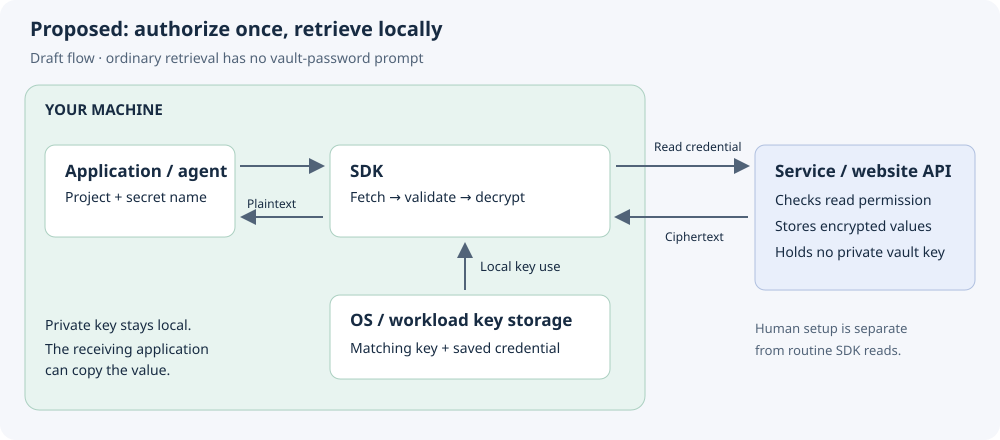

# SDK redesign proposal: authorize once, retrieve locally

Status: **superseded on 2026-11-20 by [the from-scratch design](fresh-design.md)**. The text below preserves the earlier proposal for context, not active requirements. Its legacy migration, no-recovery, immutable-key, SSH-only and approval assumptions no longer govern the new design. No deployment, migration or key replacement has occurred. For the released client, use the existing [quickstart](quickstart.md), [reference](reference.md) and [security profile](security.md).

## Confirmed product decisions

- Passwordless retrieval must support desktops and unattended Linux servers/containers in the first redesign release.
- The SDK returns plaintext to the authorized local application. Keep values out of normal model messages, tool results and logs; isolation from arbitrary code with equivalent local privileges is not required.
- Save an explicitly scoped application read credential in OS-protected local storage during human setup. Agents then supply only the project and secret name. Headless deployments use an explicitly provisioned workload credential source with equivalent access controls, without assuming a desktop keyring.
- Recovery, offline-backup tooling, support escrow and password-reset recovery are excluded. Losing all usable key copies requires replacing the affected secrets at their providers.
- Include one-time, human-approved provisioning of the existing vault key onto a server/container workload so it can access secrets already stored from the desktop. This is deliberate operational provisioning while a usable source key exists, not recovery after key loss.

These decisions are recorded as pending implementation in the [PRD](PRD.md), [accepted design record](simplified-design.md) and [delivery plan](plan.md). The remaining engineering and management-policy choices below still require a concrete implementation design.

## Product outcome

After a human sets up a machine and authorizes an application, an agent/application retrieves a value by project and name. The SDK fetches encrypted data, locates the matching local key and decrypts automatically. Ordinary reads do not ask for a vault password, open a browser or require a separate decryption script.

The project and name identify the requested value; they are not passwords. The service credential authorizes remote access. The local private key decrypts the returned ciphertext. Setup connects these pieces once so applications need not repeatedly configure them.

This proposal targets the newer Passman implementation in this workspace, rather than replacing the preserved earlier multi-machine application.

## What actually needs to change

The current `KeymanClient.getSecret` already fetches ciphertext, validates its account/vault/project/name context and decrypts it locally. Its constructor requires an unlocked `Identity`. CLI commands prompt for the local passphrase in each process, and the example requires callers to unlock the identity themselves.

Rebuild the public SDK interface and local-key access around automatic discovery. Preserve the established HPKE implementation, account bindings, ciphertext and server authorization wherever compatible. A usability redesign does not require replacing working cryptography or resetting existing secrets.

## Proposed retrieval flow



1. The application supplies a project and secret name. Its service credential comes from an explicitly configured local profile or private application configuration.
2. The SDK selects the locally configured account, service origin and vault. It never searches other accounts or silently switches identities after failure.
3. It checks that the required local key storage is available. Missing setup produces a specific setup error; it does not generate a replacement identity.
4. It requests the encrypted record over HTTPS using the read-only service credential. The service checks account/project access, expiry and revocation.
5. It validates response size, schema and the requested record's pinned account/vault/key/project/name context.
6. It obtains use of the local private key through the configured OS/workload credential source and decrypts with the existing cryptographic module.
7. It returns the plaintext value to the application. The SDK never prints it, writes a plaintext cache or adds it to `process.env` implicitly.

The SDK is part of the application; the caller runs no separate decrypt command. Ordinary calls never start interactive setup. SDK import has no enrollment, browser or key-generation side effects.

## One-time human setup

The proposed entry point remains:

```sh
passman login
```

For a new machine:

1. Explain that this machine will be allowed to decrypt during its authorized OS session.
2. Verify that a supported OS credential store or explicitly selected workload credential source is available before creating durable identity state.
3. Generate the private encryption key locally and protect it using that store. Register only the public key through the existing bound browser approval.
4. Save the account, service origin and vault fingerprint locally. Keep service credentials and private key material out of repository configuration.
5. Offer a scoped read credential for the intended application/project through human authorization. The user may instead supply an existing read credential through hidden input.
6. Store the credential in protected local storage under an explicit application profile. A project can have several application profiles; setup must resolve ambiguity rather than guess.
7. Explain the confirmed no-recovery policy. Establish any required management/provisioning password according to the final policy; routine SDK calls never request it. Do not offer a backup/recovery feature.
8. Run a metadata/status check and show only the configured account, project, profile, expiry and local-storage readiness.

Existing browser approval can remain the initial setup mechanism. Improving that approval UX is separate from making runtime retrieval automatic. Do not silently issue account-wide credentials to avoid a setup decision.

## Proposed SDK contract

These examples illustrate the API to build. They do not run against the currently released package.

With an explicitly configured default application profile:

```ts
import { PassmanClient } from "@07rjain/passman";

const passwords = await PassmanClient.connect({ project: "billing" });
const apiKey = await passwords.getSecret({ name: "PAYMENTS_API_KEY" });

// Pass apiKey directly to trusted application/provider code. Do not log it.
```

An application may supply its credential privately instead:

```ts
import { PassmanClient } from "@07rjain/passman";

const serviceKey = process.env.PASSMAN_SERVICE_KEY;
if (!serviceKey) throw new Error("Configure this application's read credential");

const passwords = await PassmanClient.connect({
  project: "billing",
  serviceKey,
});

const apiKey = await passwords.getSecret({ name: "PAYMENTS_API_KEY" });
```

Proposed contract details:

- `connect` resolves configuration and checks local readiness without prompting. It does not imply the server will authorize a later read.
- An explicit `serviceKey` selects that credential; a rejected explicit credential never falls back to a broader saved credential.
- Local profiles bind account, origin, vault and application credential. Multiple profiles require an explicit selection unless the user deliberately configured a default.
- Project/name lookup remains explicit; dotted strings are not parsed into ambiguous namespaces.
- `getSecret` returns a string, including an intentionally stored empty string. It throws a typed error for a missing value; it never returns an empty string as a failure substitute.
- `hasSecret` and `search` remain metadata-only. Authorization/network failures are not reported as an absent secret.
- Runtime credentials remain read-only. Retrieval does not acquire upload, delete, project-administration or credential-issuance permission.
- Do not accept a vault password or a raw private key in the ordinary retrieval API.
- Public SDK exports, environment variable names and supported Node.js versions require explicit compatibility/versioning decisions before implementation.

## Where the key lives, and what the vault password means

Passwordless retrieval requires a local authorization source that works without the vault password. Recommended desktop design: an OS-protected random wrapping key unlocks the encrypted operational identity. The SDK's local-key module handles this internally. It must not store the vault password in a file to simulate automatic access.

The platform implementations should use macOS Keychain, Windows current-user protected storage and Linux Secret Service or another explicitly supported OS facility. Their availability and access behavior must be verified on real supported systems. Linux installations do not universally have an unlocked desktop keyring.

The vault password would gate supported key provisioning/export and management operations. Recovery and portable-backup tooling are excluded. The operational key has a separate OS/workload-authorized access path. Therefore the password is **not the exclusive cryptographic gate to the key** in this design.

A password prompt in an export command cannot prevent equally privileged local code from reading an automatically available key or calling decryption. Existing software-held X25519 keys should not be described as hardware-backed or non-exportable. Stronger protection would require compatible hardware/OS key operations and a separately tested isolation boundary.

No extra wrapping keys or envelope terminology should be required in the user's ordinary workflow.

## Operation and password behavior

| Operation | Vault password | Other authority |
| --- | --- | --- |
| Retrieve a permitted value | No | Read credential and locally available OS/workload-protected key |
| Search/check metadata | No | Read credential; private-key use is unnecessary |
| Add/replace a value locally | No | Separate administrative upload authorization; encryption uses a public key |
| Create projects or issue/revoke credentials | No | Human account authorization, with recent verification where appropriate |
| Provision the existing key onto a workload | Yes in the proposed supported workflow | Human/local authorization and authenticated destination; exact mechanism still to finalize |
| Change management password or key-access policy | Yes in the proposed supported workflow | Local OS authorization where available |
| Rotate the vault encryption key | Separate explicit operation | Human authorization and a tested re-encryption/migration plan |
| Delete a remote value | Proposed: confirmation and human authorization | No read credential may delete |
| Delete the local vault | Proposed: strong destructive confirmation | Warn about unrecoverable loss; password policy needs a product decision |

Ordinary data changes are different from changes to key custody. Adding a password should not require the vault password; changing how the private key can be exported should.

Changing a management password does not rotate provider secrets or invalidate key copies already provisioned elsewhere. Deleting a key from one machine does not revoke a copy elsewhere.

## Restarts, locks and headless applications

- After an application restart, it loads the same protected local profile automatically.
- After a desktop reboot, retrieval resumes when the authorized OS credential store becomes available, commonly after OS login. Do not promise access before login.
- A locked or denied OS store returns `LOCAL_KEY_LOCKED` with human remediation. The agent must not enter a loop asking for a vault password. Whether an OS facility itself displays a prompt depends on its policy; validate this for every claimed platform.
- An explicitly supported manual-lock feature must deny local key use across new processes, rather than clearing only one SDK instance. It cannot erase keys/plaintext already copied by an application.
- Headless/container workloads are required in the first release. Use a dedicated supported custody mechanism such as OS service credentials or runtime-mounted deployment secrets to unlock the encrypted operational profile. A desktop keyring cannot be assumed. A server allowed to decrypt is itself a trusted client host.
- Unavailable secure storage never causes a fallback to a plaintext key or a password saved beside the vault.

For unattended Linux services, a proposed baseline is an encrypted operational profile persisted outside disposable process state, with its random unlock key supplied by a supported service-credential facility. For containers, mount the encrypted profile and separately provisioned runtime unlock material read-only under the intended workload identity. Store the scoped read credential through the same approved custody adapter. The precise supported systemd/container adapters and at-rest guarantees must be verified before claiming support.

Routine restarts and authorized container replacements reuse the provisioned identity and runtime credential source. They never generate a fresh vault key, invoke browser login or require the management password. Host reboot support requires the credential source itself to become available unattended. A missing volume or denied secret mount fails with a typed setup/storage error.

Do not bake keys, read credentials or unlock material into images, Dockerfiles, build arguments, repository files, command-line arguments or model messages. Secret mounts do not inherently prove encrypted persistence: the deployment's secret facility and its administrators are part of the trust boundary. Neither usable vault keys nor unlock material are sent to the Passman storage service or Clerk. The user's trusted workload infrastructure necessarily has key-use authority.

## Agent behavior when something goes wrong

| Proposed error | Meaning and next step |
| --- | --- |
| `SETUP_REQUIRED` | This machine/application is not configured; a human completes setup once |
| `PROFILE_REQUIRED` | Several accounts/profiles match; explicitly choose one |
| `LOCAL_KEY_LOCKED` | OS key access is locked/denied; a human restores the authorized OS session |
| `CREDENTIAL_REQUIRED` | Configure an application read credential privately |
| `CREDENTIAL_EXPIRED` / `CREDENTIAL_REVOKED` | A human replaces/renews application authorization; never silently extend it |
| `FORBIDDEN` | The selected credential lacks permission; do not try a broader account credential |
| `SECRET_NOT_FOUND` | The authorized lookup found no value; offer a secure human input path |
| `KEY_MISMATCH` | Wrong local identity or record binding; preserve the existing key and stop |
| `INTEGRITY_FAILED` | Ciphertext/context validation failed; return no plaintext |
| `UNAVAILABLE` | A bounded network/service failure; return no cached plaintext |

These are intended SDK distinctions, not current API guarantees. Expired/revoked/forbidden cases require a deliberate server error contract that does not leak credential state to unauthorized callers.

An agent should request user action only for a concrete missing prerequisite. When a secret is missing, the user enters it through a trusted local hidden-input flow; the agent never asks for it in chat. After storage and authorization, the same SDK call works. Runtime reads cannot create missing secrets automatically.

Network retries must be bounded and limited to safe reads. Authentication, context and integrity failures are never retried with weaker checks. Offline plaintext caching is outside the initial redesign; ciphertext cached by an attacker remains decryptable with a stolen matching key regardless of later server revocation.

## Security expectations

- **Server/database access alone:** stored provider values remain encrypted if the attacker lacks client private material. Metadata is readable. An active malicious server can deny service and the current HPKE base-mode profile does not prove writer authenticity or independently checked freshness.
- **Read credential alone:** permits scoped ciphertext/metadata retrieval, not local decryption. The running API receives usable bearer credentials during normal authentication.
- **Private key plus matching ciphertext:** allows offline decryption without the service credential. A private key covers its vault; project API scopes do not become separate cryptographic keys.
- **Authorized local host compromise:** can expose key use and retrieved plaintext. Automatic retrieval deliberately trusts that host's authorized OS context.
- **Hosted input or malicious client update:** can capture new input or local secrets at the point of use. Preserve local input guidance and signed distribution checks.
- **Revocation:** blocks future authorized server retrieval after enforcement; it cannot erase copied plaintext, keys or ciphertext.

An SDK returning plaintext supports a model-facing tool that uses a credential internally and returns task results. It does not isolate an arbitrary-code agent running with the same OS permissions. Saved application profiles are credential organization, not proof of per-process isolation. If the model must be unable to extract values, use a separate restricted executor with task-specific tools; a generic get-password tool exposes the password to its caller.

## One-time workload provisioning

The user confirmed that workloads must access existing desktop-stored secrets. A new key generated on the workload cannot decrypt those records. Provision the existing identity deliberately, preserving its account, origin, vault ID, public key and private key. Issue or explicitly select a separate project-scoped read credential for that application; never copy administrative upload authority implicitly.

Proposed first-release transport: use the user's existing SSH access to the Linux workload host, with verified host identity and normal SSH authentication. Build on the established SSH transport rather than inventing a short-code or key-transfer cryptographic protocol. This transport choice is an engineering proposal, not a completed security review.

1. A human starts provisioning from a machine with a usable vault key and confirms the intended destination and project. Apply the final management-password policy here.
2. Verify the destination's SSH host key through an established trusted path. Never silently accept an unknown or changed host key or disable host-key checking.
3. Run a compatible destination helper under the intended workload identity. Check its supported credential store, private persistent paths and installed version before sending key material.
4. Transfer only the required existing vault identity and explicitly authorized application read credential through the authenticated SSH channel. Private material travels through protected process input, never shell arguments, terminal output, temporary plaintext archives or Passman API endpoints. Do not forward the desktop's upload token.
5. The destination encrypts and persists the operational profile using its approved local/runtime credential source. It verifies the account/key binding and an authorized test decryption, returning only a redacted completion status and public fingerprint.
6. For a container deployment, an operator mounts that provisioned workload profile and its approved credential source into the runtime. Provisioning is not repeated at every container startup. Deployment orchestration that bypasses the host helper needs its own reviewed custody adapter.
7. Record safe local provisioning status without treating server ciphertext-read audit events as proof of key transfer or successful decryption. Specify atomic writes, interruption/retry behavior and cleanup before shipping.

The source and destination must not silently fall back to a different account, broader credential, root execution or weaker key storage. If provisioning fails, preserve the source identity and any pre-existing destination vault. A disconnected completion is an uncertain outcome that needs explicit status inspection, not blind reissuance of credentials.

Copying the key shares the vault's cryptographic decryption authority. Separate project-scoped service credentials restrict online API access and can be revoked independently; they do not prevent offline decryption with already obtained ciphertext. Revoking one read credential does not revoke a copied private key. Independently revocable per-device encryption identities remain outside this redesign.

## Machine loss and no recovery

No recovery, offline-backup tooling, recovery codes, account-only reset or support escrow is included. A database backup contains ciphertext, not client-key recovery. Losing every usable key copy means replacing affected credentials at their providers. Do not advertise authenticated workload provisioning as a recovery service.

If an already provisioned workload still has a usable key, then all key copies have not been lost; account login still cannot reconstruct that material. A fresh machine, management-password reset or replacement service credential cannot decrypt orphaned ciphertext.

## Compatibility and delivery

1. Preserve the confirmed scope and finalize the remaining implementation and management-policy decisions below. The current manual-passphrase requirement changes explicitly; no silent fallback is permitted.
2. Implement and verify desktop OS-backed custody and unattended Linux/container adapters. Keep platform storage, network requests and existing crypto as separate internal responsibilities; a new mandatory daemon is unnecessary for the ordinary same-user SDK model. Include authenticated one-time workload provisioning with independently scoped read credentials.
3. Add automatic local-profile discovery, private credential configuration and the proposed SDK interface. Keep legacy clients operational during a documented compatibility period.
4. Migrate an existing identity only after one successful old-passphrase unlock. Preserve its private/public key, account, vault ID and ciphertext. Stage protected storage, verify the persisted key and decrypt an existing synthetic record before committing migration; preserve rollback data until success.
5. Make interruption/retry safe and explicit. A failed migration must never overwrite the sole usable identity. Keep the old encrypted file until the user deliberately retires it, explaining that it remains another valid key copy.
6. Align CLI behavior, error guidance, examples, agent instructions and release notes. Version new public API/local formats explicitly; no server/database format change is assumed.
7. Test installed artifacts and upgrades, then release intentionally. Local tests are not deployment or independent security review.

Acceptance must include: first setup; two fresh SDK processes retrieving without a passphrase/script; actual desktop logout/reboot behavior; unattended Linux host reboot and container replacement; missing/denied secure storage; no plaintext fallback; wrong profile/account/key; revoked/expired credentials; tampered/context-swapped records; missing and empty values; separate write authority; redacted errors/logs; interrupted migration and unchanged existing data; supported-platform installed packages. Workload provisioning must cover existing-secret retrieval, wrong/changed SSH host identity, destination permissions, no inherited upload authority, interrupted completion, source preservation and independent read-credential revocation. Verify that total key loss has no recovery bypass.

## Remaining design decisions

1. Finalize the supported Linux service/container credential adapters, installation prerequisites and verified at-rest/access guarantees. Generic containers cannot supply an OS credential store without provisioning.
2. Finalize the SSH destination-helper and management-authorization contract, including credentials issuance, version checks, atomic installation and uncertain completion behavior.
3. Confirm the management-password setup policy. Proposed default: establish it once during initial setup/migration, require it for supported key provisioning and custody-policy changes, and omit it from routine reads and secret writes.
4. Confirm local vault deletion policy. Proposed default: explicit destructive confirmation with the key-loss warning, without requiring the management password. The OS owner can delete local files outside the product regardless.

No product code, keys or server state have changed. Confirmed scope is distinct from final implementation approval and release acceptance.
